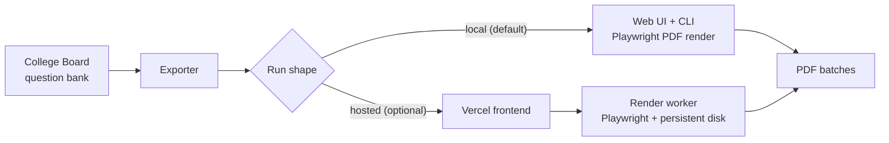

# SAT Question Bank Exporter

> Unofficial exporter that turns the College Board question bank into printable SAT practice sets

[한국어](README.md) · [MIT License](LICENSE) · Node.js 20+

The College Board question bank is online-only, which makes printing or handing out
practice sets a hassle. This tool lets you pick an assessment, section, domains,
skills, difficulty, question count, and batching rules, then **renders polished PDF
practice sets on your own machine**.

**Local-first — it runs on your machine with no account and no hosting.** An optional
hosted path (Vercel frontend + Render worker) is available if you want it.

Not an official College Board project.

## Architecture



## Quick start

For release builds or local zip copies, double-click the launcher.

- Windows: [`launch.bat`](./launch.bat)
- macOS: [`launch.command`](./launch.command)

The launcher checks whether Node.js is installed, runs first-time setup automatically
when dependencies or Playwright Chromium aren't ready, starts the local server, and
opens the app at `http://localhost:4173`. PDFs are saved to the project's `output/`
folder by default.

To run manually instead of the launcher:

```bash
npm install
node node_modules/playwright/cli.js install chromium
npm start
```

## Features

| Feature | Description |
|---------|-------------|
| Lookup loading | Loads SAT Suite lookup data from the College Board question bank |
| Filtering | Filters questions by section, domains, skills, and difficulty |
| Preview | Shows how many questions match before exporting |
| PDF render | Renders student/teacher/clean batches locally with Playwright |
| Answer key | Optionally appends an answer key and rationale section after each batch |
| Dedupe | Skips questions already exported on this machine |

## CLI

The web UI is recommended, but the CLI still works.

```bash
npm run export -- \
  --assessment "SAT" \
  --section "Math" \
  --domains "Algebra" \
  --skills "Linear functions" \
  --difficulty "Easy,Medium" \
  --question-count 20 \
  --chunk-size 10 \
  --mode student \
  --output ./output/math
```

| Option | Description |
|--------|-------------|
| `--question-count 20` | Total questions to export |
| `--chunk-size 10` | Questions per PDF file |
| `--difficulty "Easy,Medium"` | Difficulty filter |
| `--skills "Linear functions,Inferences"` | Skill filter |
| `--include-answer-key true` | Append answer key and rationale per batch |
| `--exclude-active true` | Skip active/live items |
| `--exclude-exported true` | Skip already-exported questions |
| `--preview` | Show counts without rendering |

### Export modes

| Mode | Contents |
|------|----------|
| `student` | Prompts only |
| `teacher` | Includes answers and rationale |
| `clean` | Minimal formatting and headers |

### Local export history

Enabling `Skip previously exported questions` (UI) or `--exclude-exported true` (CLI)
consults a local cache at `.sat-exporter/export-history.json`. That file is only used
on your machine and is not meant to be committed.

## Configuration reference

Local all-in-one needs no environment variables. The ones below are for split hosted
deployment.

| Environment variable | Description |
|---|---|
| `SAT_WORKER_BASE_URL` | Worker URL the web app forwards preview/export/job-status/history requests to. Unset means local all-in-one |
| `SAT_EXPORT_STORAGE_DIR` | Where the worker stores export artifacts (`render.yaml` uses `/var/data/sat-qbank`) |
| `SAT_EXPORT_HISTORY_PATH` | Export-history file path (defaults into the storage dir when unset) |

## Hosted deployment (optional)

The local all-in-one flow works whenever `SAT_WORKER_BASE_URL` is unset. To host, split
the frontend and worker.

- `npm start` — web app server
- `npm run start:worker` — dedicated export worker

**Vercel frontend:** [vercel.json](./vercel.json) skips install/build, serves `public/`
statically, and leaves `/api/*` unconfigured so the browser falls back to workerless mode.

**Render worker:** Deploy as a **Web Service**, not a Background Worker (the Vercel
frontend needs a public HTTPS endpoint for `/api/*`). [Dockerfile](./Dockerfile) is a
Playwright-ready image and [render.yaml](./render.yaml) is a Render Blueprint. Keep the
health check path at `/api/health`. After deploy, set the worker URL as
`SAT_WORKER_BASE_URL` in Vercel and redeploy.

## Development

```bash
npm test   # node --test
```

## Notes

- Use within College Board terms and your local copyright boundaries.
- Behavior may change if the upstream question bank changes.
- This repository is designed for local use, not as a hosted service.

## License

[MIT](LICENSE) © 2026 AhnRyu
