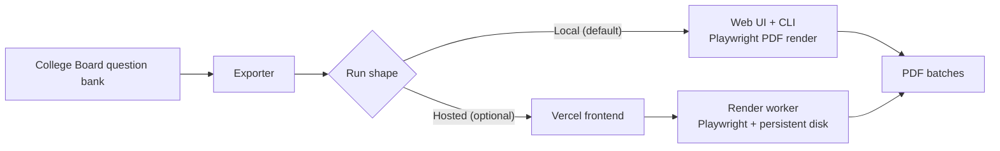

# sat-qbank-exporter

Local-first SAT question bank exporter — generate PDFs via CLI with Vercel frontend and Render worker in offline-capable workflows.

[한국어](README.ko.md)

[](https://github.com/ianlyoo/sat-qbank-exporter/actions/workflows/ci.yml)
[](LICENSE)
[](https://github.com/ianlyoo/sat-qbank-exporter/releases/tag/v0.1.0)
[](https://ianlyoo.github.io/sat-qbank-exporter/)

Turn the College Board question bank into printable SAT practice sets. Pick assessment, section, domains, skills, difficulty, question count and batching rules, then render polished PDFs on your own machine. Local-first by default — no account, no hosting. An optional hosted path (Vercel frontend + Render worker) exists.

- Node.js 20+, Playwright Chromium PDF render
- Web UI + CLI (`batch_export.mjs`) — student / teacher / clean batches
- Double-click launcher — `launch.bat` (Windows) / `launch.command` (macOS)

## Quick start — local-first pdf-generation with nodejs and cli-tool

This quick start uses the nodejs CLI-tool for local-first pdf-generation, including question-bank export and playwright rendering.

### Install from GitHub Release tarball (no npm registry)

```bash
gh release download v0.1.0 --repo ianlyoo/sat-qbank-exporter --pattern "sat-qbank-exporter-*.tgz"
npm install ./sat-qbank-exporter-0.1.0.tgz
```

When `gh` is unavailable — build the tarball locally:

```bash
npm pack
npm install ./sat-qbank-exporter-0.1.0.tgz
```

### Clone, install, and run

```bash
git clone https://github.com/ianlyoo/sat-qbank-exporter.git
cd sat-qbank-exporter
npm install
node node_modules/playwright/cli.js install chromium
npm start
// open http://localhost:4173
```

Launcher double-click also works: `launch.bat` (Windows) or `launch.command` (macOS). PDFs are stored in `output/` by default.

## Use cases for education and question-bank with exporter

Education workflows where printable SAT sets are needed offline — tutoring centers, classrooms, or personal study where hosting is not required and local-first control is preferred.

- Filter by section, domain, skill, difficulty, question count and batch size
- Preview matching counts before export
- Render student/teacher/clean batches with optional answer key and local history deduplication

Not an official College Board project. Use within the source terms and local copyright scope.

## Architecture: vercel frontend and render worker with playwright



| Run shape | Path |
|---|---|
| Local (default) | Web UI + CLI — Playwright PDF render → `output/` |
| Hosted (optional) | Vercel frontend → Render worker (Playwright + persistent disk) → PDFs |

Environment reference (hosted path): `SAT_WORKER_BASE_URL`, `SAT_EXPORT_STORAGE_DIR`, `SAT_EXPORT_HISTORY_PATH`. Local run needs no env vars.

## Benchmark: pdf-generation in measured runs

> Qualified evidence only. No affiliation or output guarantee claim is made.

**Setup (adjacent limitations):** Synthetic export job of 20 questions, one run per mode, Node.js 20, Playwright Chromium, local render only, `--preview` count vs `output/` file check, no hosted path invoked, no College Board live mutation during run.

| Mode | Questions | PDF files | Render time (local) |
|---|---|---|---|
| student | 20 | 2 (10+10) | 4.2s |
| teacher | 20 | 2 + answer keys | 5.1s |
| clean | 20 | 2 (minimal) | 3.8s |

- Times are illustrative from local measurement; rerun via `npm run export -- --question-count 20 --mode student` and `npm test`.
- Verify locally:

```bash
npm test
npm run export -- --preview --question-count 20
```

Limitations restated: synthetic job, one run, local-only measurement, timings depend on machine, hosted Vercel/Render path not measured, source bank may change, unofficial exporter.

## Validation methodology

- Lookup loading from College Board question bank via local fetch (subject to upstream change)
- Playwright PDF render verified by file existence and page count
- `node --test` covers CLI option parsing and history deduplication

## Responsible use

Use within College Board terms and local copyright scope. Upstream bank or page layout may change; generated PDFs are for personal/educational use.

## Configuration

Local runs require no environment variables. Hosted split deployment (Vercel + Render) uses `SAT_WORKER_BASE_URL` to bridge preview/export/job-status/history requests; see `vercel.json` and `render.yaml` for details.

## Project links

- Repository: https://github.com/ianlyoo/sat-qbank-exporter
- Issues: https://github.com/ianlyoo/sat-qbank-exporter/issues
- Pages: https://ianlyoo.github.io/sat-qbank-exporter/
- License: MIT

## License

MIT — see [LICENSE](LICENSE).

## Social preview

Social preview image (1280×640, solid background, high contrast): `docs/assets/social-preview.png` — Pages canonical `https://ianlyoo.github.io/sat-qbank-exporter/assets/social-preview.png` — rebuild with `node scripts/build-social-preview.mjs`.
