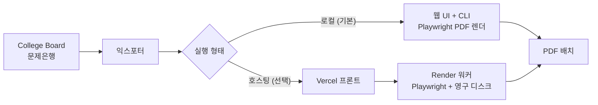

# SAT Question Bank Exporter

> College Board 문제은행에서 인쇄용 SAT 연습 세트를 뽑아내는 비공식 익스포터

[English](README.en.md) · [MIT License](LICENSE) · Node.js 20+

College Board 문제은행은 온라인으로 풀게만 되어 있어, 종이로 뽑아 풀거나 배포하기가
번거롭다. 이 툴은 assessment·섹션·도메인·스킬·난이도·문항 수·배치 규칙을 골라
**깔끔한 PDF 연습 세트를 내 기기에서 렌더링**한다.

**로컬 우선이다 — 계정도, 호스팅도 없이 내 기기에서 돈다.** 원하면 Vercel 프론트 +
Render 워커로 호스팅하는 선택 경로가 따로 있다.

College Board 공식 프로젝트가 아니다.

## 아키텍처



## 빠른 시작

릴리스 빌드나 로컬 zip 사본이라면 런처를 더블클릭한다.

- Windows: [`launch.bat`](./launch.bat)
- macOS: [`launch.command`](./launch.command)

런처는 Node.js 설치 여부를 확인하고, 의존성·Playwright Chromium이 준비되지 않았으면
최초 1회 세팅을 자동 실행한 뒤 로컬 서버를 띄우고 브라우저에서 `http://localhost:4173`을
연다. PDF는 기본적으로 프로젝트의 `output/` 폴더에 저장된다.

런처 없이 직접 실행하려면:

```bash
npm install
node node_modules/playwright/cli.js install chromium
npm start
```

## 기능

| 기능 | 설명 |
|------|------|
| Lookup 로딩 | College Board 문제은행에서 SAT Suite lookup 데이터를 불러옴 |
| 필터 | 섹션·도메인·스킬·난이도로 문항 필터링 |
| 미리보기 | 내보내기 전에 매칭되는 문항 수를 확인 |
| PDF 렌더 | Playwright로 student/teacher/clean 배치를 로컬 렌더 |
| 답지 첨부 | 각 배치 뒤에 답과 해설 섹션을 선택적으로 추가 |
| 중복 제외 | 이 기기에서 이미 내보낸 문항을 건너뜀 |

## CLI

웹 UI가 권장 방식이지만 CLI도 동작한다.

```bash
npm run export -- \
  --assessment "SAT" \
  --section "Math" \
  --domains "Algebra" \
  --skills "Linear functions" \
  --difficulty "Easy,Medium" \
  --question-count 20 \
  --chunk-size 10 \
  --mode student \
  --output ./output/math
```

| 옵션 | 설명 |
|------|------|
| `--question-count 20` | 총 내보낼 문항 수 |
| `--chunk-size 10` | PDF 파일당 문항 수 |
| `--difficulty "Easy,Medium"` | 난이도 필터 |
| `--skills "Linear functions,Inferences"` | 스킬 필터 |
| `--include-answer-key true` | 배치마다 답지·해설 섹션 첨부 |
| `--exclude-active true` | active/live 문항 제외 |
| `--exclude-exported true` | 이미 내보낸 문항 제외 |
| `--preview` | 렌더링 없이 문항 수만 표시 |

### 출력 모드

| 모드 | 내용 |
|------|------|
| `student` | 문제만 |
| `teacher` | 답과 해설 포함 |
| `clean` | 최소 서식·헤더 |

### 로컬 내보내기 히스토리

`이미 내보낸 문항 건너뛰기`(UI) 또는 `--exclude-exported true`(CLI)를 쓰면 로컬 캐시
`.sat-exporter/export-history.json`을 참조한다. 이 파일은 내 기기에서만 쓰이며 커밋 대상이 아니다.

## 설정 레퍼런스

로컬 올인원 실행에는 환경변수가 필요 없다. 아래는 호스팅 분리 배포용이다.

| 환경변수 | 설명 |
|---|---|
| `SAT_WORKER_BASE_URL` | 웹앱이 preview/export/job-status/history 요청을 넘길 워커 URL. 미설정 시 로컬 올인원 |
| `SAT_EXPORT_STORAGE_DIR` | 워커의 내보내기 산출물 저장 경로 (`render.yaml`은 `/var/data/sat-qbank`) |
| `SAT_EXPORT_HISTORY_PATH` | 내보내기 히스토리 파일 경로 (미설정 시 저장 디렉토리 기본값) |

## 호스팅 배포 (선택)

로컬 올인원 흐름은 `SAT_WORKER_BASE_URL`이 없을 때 그대로 동작한다. 호스팅하려면
프론트/워커를 분리한다.

- `npm start` — 웹앱 서버
- `npm run start:worker` — 전용 내보내기 워커

**Vercel 프론트:** [vercel.json](./vercel.json)이 install/build를 건너뛰고 `public/`을
정적 서빙하며 `/api/*`를 비워 브라우저가 workerless 모드로 fallback하게 한다.

**Render 워커:** Background Worker가 아니라 **Web Service**로 배포한다 (Vercel 프론트가
`/api/*`용 공개 HTTPS 엔드포인트를 필요로 함). [Dockerfile](./Dockerfile)은 Playwright
준비 이미지, [render.yaml](./render.yaml)은 Render Blueprint다. 헬스체크 경로는
`/api/health`. 배포 후 워커 URL을 Vercel의 `SAT_WORKER_BASE_URL`에 넣고 재배포한다.

## 개발

```bash
npm test   # node --test
```

## Notes

- College Board 약관과 현지 저작권 범위 안에서 사용한다.
- 업스트림 문제은행이 바뀌면 동작이 달라질 수 있다.
- 이 리포는 호스팅 서비스가 아니라 로컬 사용을 전제로 설계되었다.

## License

[MIT](LICENSE) © 2026 AhnRyu
